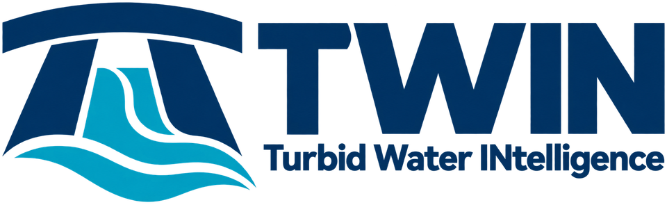
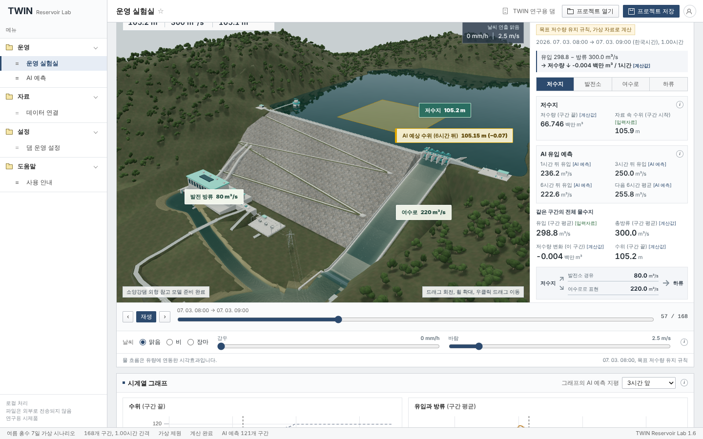
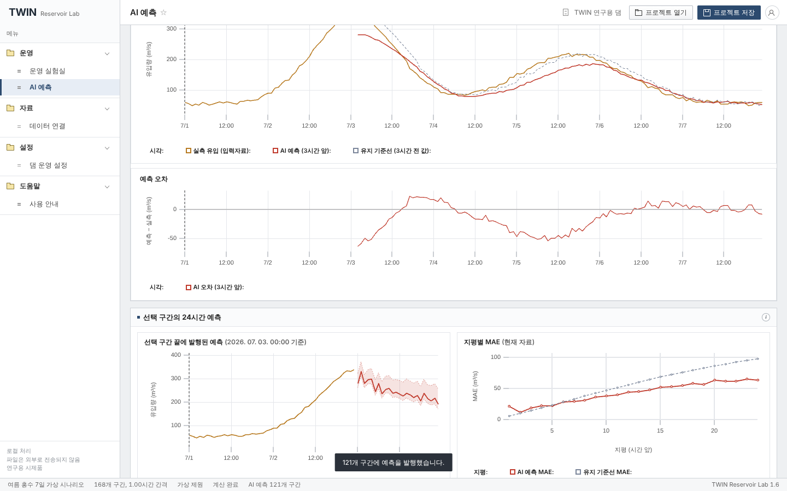

<p align="center"></p>

# TWIN Reservoir Lab

팀 TWIN(Turbid Water INtelligence)의 연구용 댐 운영 시뮬레이터이자 디지털 트윈 시제품입니다. 소양강댐 외형을 참고한 3D 장면, 물수지 운영 모형, 2024년 소양강댐 공개자료로 학습한 LSTM 유입량 예측기를 한 프로그램에 담았습니다. 인터넷 연결 없이 동작하며 모든 자료는 사용자의 컴퓨터 안에서만 처리됩니다. 실제 댐 운영이나 안전 판단에는 사용할 수 없습니다.

현재 버전 **1.6.1** (2026-10-19)

## 다운로드

[Releases](../../releases/latest)에서 운영체제에 맞는 파일을 받습니다.

| 운영체제 | 파일 | 설치 |
|---|---|---|
| Mac (Apple Silicon, M1 이후) | `TWIN_Reservoir_Lab_1.6.1_mac_arm64.zip` | zip을 풀고 `설치.command`를 오른쪽 클릭해 "열기". 응용 프로그램 폴더(~/Applications)에 복사되고 실행됩니다. [자세히](dist/설치안내_Mac.txt) |
| Windows 10, 11 (64비트) | `TWIN_Reservoir_Lab_1.6.1_win_x64.zip` | zip을 풀어 나온 `TWIN Reservoir Lab` 폴더를 원하는 곳에 두고 `바로가기 만들기.bat`를 실행한 뒤 바로 가기로 엽니다. [자세히](dist/설치안내_Windows.txt) |

두 묶음 모두 유료 개발자 인증서로 서명하지 않은 연구용 시제품이라 첫 실행 때 보안 경고가 한 번 나옵니다. Mac은 "확인되지 않은 개발자"(macOS 15는 시스템 설정의 "그래도 열기"), Windows는 SmartScreen "추가 정보 > 실행"으로 넘기면 됩니다. 파일 확인값은 [dist/SHA256SUMS.txt](dist/SHA256SUMS.txt)에 있습니다.

설치 없이 웹에서 바로 써 보려면 **https://jjinttaim.github.io/TWIN-Reservoir-Lab/** 을 엽니다(`gh-pages` 브랜치, 처음 열 때 3D 모델 40 MB를 내려받습니다). 데스크톱 앱과 같은 프로그램이며 불러온 파일은 브라우저 안에서만 처리됩니다.

소스로 쓰려면 `app` 폴더에서 `python3 serve.py`를 실행하고 안내된 주소를 엽니다(3D 모델 파일 때문에 `file://`로는 열리지 않습니다).

## 화면

| 운영 실험실 | AI 예측 |
|---|---|
|  |  |

3D 장면에서 취수탑 앞의 노란 표시면과 라벨이 AI 예측 유입량으로 계산한 예상 수위입니다. AI 예측 화면은 실측과 예측, 오차, 선택 구간의 24시간 예측과 경험적 범위, 지평별 MAE, 2024년 평가표를 보여 줍니다. 더 많은 화면은 [docs/screenshots](docs/screenshots)에 있습니다.

## 무엇이 들어 있나

- **운영 실험실**: 168시간 가상 시나리오 또는 불러온 실제 자료로 기준 운영안과 제안 운영안(고정 방류, 관측 재현, 목표 저수량 유지 규칙, AI 예측 참고 규칙)을 같은 조건에서 비교합니다. 수위와 유량에 연동된 3D 장면, 시점 10종, 날씨 표현, PNG 저장, 시간 재생.
- **AI 예측**: 직전 48시간 유입량으로 1~24시간 뒤 유입량을 예측하는 LSTM(은닉 64, 1층)이 브라우저 JavaScript 안에서 실행됩니다. PyTorch 검증 벡터와 일치하는지 자동 시험으로 확인했습니다.
- **데이터 연결**: CSV와 Excel(시트, 머리글 행 선택), 열 연결, 단위 변환, 자료 검사.
- **댐 운영 설정**: 저수용량, 발전 용량, 수위와 저수량 관계표, 예측 참고 지평 등.
- **데스크톱 앱**: Electron으로 포장한 Mac(arm64)과 Windows(x64) 앱. 사설 `twin://` 스킴으로 앱 파일을 읽어 서버와 네트워크가 필요 없습니다.

## AI 결과 요약 (2024년 소양강댐 공개자료, 7~9월 주평가, 3시간 앞, 2,190개 발행 시각)

| 방법 | MAE (m³/s) |
|---|---:|
| 유지 기준선 | 53.4 |
| 6행 평균 | 56.6 |
| Ridge | 47.7 |
| HGB | 62.6 |
| **LSTM** | **44.3** |
| Transformer | 49.5 |

LSTM은 Ridge보다 7.1%, 유지 기준선보다 17.0% 오차가 작았고 두 차이의 블록 부트스트랩 95% 범위가 0을 포함하지 않습니다. Transformer는 Ridge와의 차이 근거가 부족했습니다. 다만 고유입 구간(실측 122.4 m³/s 이상, 791개)에서 LSTM의 평균 과소예측(67.4)은 유지 기준선(51.2)보다 커서 홍수 대응 성능이 좋아졌다고는 말하지 않습니다. 학습과 평가 절차, 전체 표, 보고서에 쓸 수 있는 문장과 쓸 수 없는 문장은 [ai/README_AI_만드는법.md](ai/README_AI_만드는법.md)와 [app/docs/AI_예측_안내.md](app/docs/AI_예측_안내.md)에 있습니다.

프로그램 안의 AI는 유입량 예측기이며 방류를 결정하지 않습니다. "AI 예측 참고 규칙"은 예측값을 목표 저수량 유지 규칙에 넣는 것이고, 최적화(MPC)나 강화학습이 아닙니다.

## 폴더 구조

```
app/        프로그램 소스 (index.html, src/, assets/, tests/, docs/, desktop/, 사용안내.md)
  src/      물수지 모형(model.mjs), AI 추론(ai-forecast.mjs), 화면(app.mjs), 3D(viewer3d.mjs) 등
  assets/   번들(app.js), 스타일, 3D 모델(twin-dam.glb, .blend), AI 모형(ai/model.json), 로고(brand/)
  desktop/  Electron 포장 (npm run pack:mac, npm run pack:win)
  docs/     3D 장면 안내, AI 예측 안내, 검증 결과, 자료 형식 등
ai/         AI 학습과 평가 (code/01~07, 결과/, README_AI_만드는법.md)
data/       K-water 소양강댐 2024년 시간자료 원문 CSV (data/README.md 참고)
dist/       배포 묶음의 안내문과 SHA-256 (묶음 본체는 Releases)
docs/       README용 화면 캡처
```

## 직접 실행하고 만들기

- 웹 앱: `cd app && python3 serve.py` (Python 3). 개발은 `npm install`, `npm test`(자동검사 83개), `npm run build`.
- 데스크톱 앱: `cd app/desktop && npm install && npm run pack:mac` 또는 `npm run pack:win`. Windows 묶음은 Linux나 Mac에서도 Wine 없이 만들 수 있도록 아이콘과 버전 정보를 `win-resources.mjs`로 exe에 직접 써 넣습니다. 자세한 내용은 [app/desktop/설치안내.md](app/desktop/설치안내.md).
- AI 학습 재현: `cd ai && python3 code/01_prepare.py ../data/소양강댐_2024_시간별_원문23열.csv 결과` 부터 `02`, `06`, `07` 순서로 실행합니다(pandas, scikit-learn, PyTorch). 같은 입력과 같은 라이브러리 버전이면 결과가 재현됩니다.

## 자료 출처와 한계

- `data/`의 원문은 공공데이터포털에 공개된 K-water 소양강댐 2024년 시간자료입니다. 공개 총유입량은 저수량과 방류로 산정된 값이며 독립 실측치가 아닙니다. 시각의 정의(구간 시작인지 끝인지)와 공개 지연은 아직 K-water에 확인하지 못했습니다.
- 3D 장면은 소양강댐의 형태를 참고한 표현용 모델이며 측량 자료나 CFD 해석이 아닙니다. 기본 제원과 가상 시나리오는 모두 가상입니다.
- AI는 2024년 한 해 공개 유입량만으로 학습했고 강우나 상류 관측을 쓰지 않습니다.

## 제3자 구성요소

Three.js, uPlot, SheetJS Community Edition, Electron, esbuild를 사용합니다. 라이선스는 [app/THIRD_PARTY.md](app/THIRD_PARTY.md)와 `app/assets/*-LICENSE.txt`에 있습니다. AI 가중치는 PyTorch로 학습했으며 프로그램 실행에는 PyTorch가 필요 없습니다.
