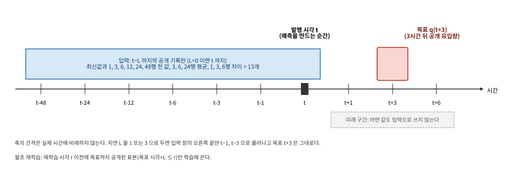
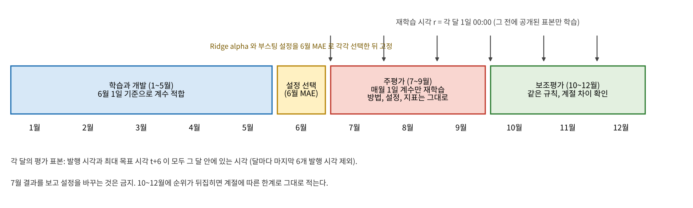
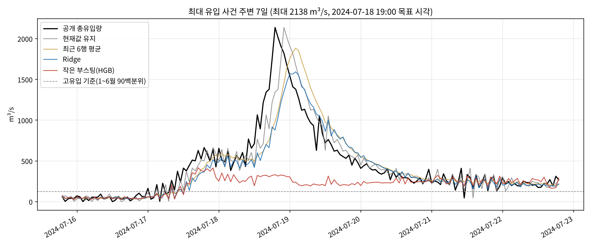

# TWIN AI 만드는 법 (v1 Ridge와 부스팅, v2 LSTM과 Transformer, 실행 완료 기록 포함)

작성일 2026-10-18 (v1), 2026-10-19 (v2 추가, 10절), 대상 자료 소양강댐 2024년 K-water 공개 시간자료, 설계 근거 `AI_구축계획_20261014/TWIN_AI_구축계획.md`

이 문서는 10월 14일 계획서에 적힌 AI를 실제로 어떻게 만들고 돌리는지 설명한다. 계획서의 규칙을 그대로 코드로 옮겼고, 2026년 10월 18일에 한 번 끝까지 실행했다. 결과는 `결과/` 폴더에 있으며 이 문서에도 핵심 숫자를 적었다. 이 실행은 최종 공개자료를 이용한 후향 평가이며, 실시간 운용 검증이 아니다.

## 1. 한눈에 보기

| 항목 | 내용 |
|---|---|
| AI가 하는 일 | 발행 시각 t까지의 공개 유입량 기록만 보고 3시간 뒤 공개 총유입량 q(t+3)을 예측한다. 1시간, 6시간은 보조다. |
| 비교 대상 | 현재값 유지, 최근 6행 평균 유지, Ridge 회귀, 작은 부스팅(HistGradientBoosting) |
| 평가 방식 | 1~5월 학습, 6월 설정 선택, 7~9월 주평가(매월 1일 계수만 재학습), 10~12월 보조평가 |
| 이번 실행 결과 | 7~9월 주평가에서 Ridge가 가장 정확했고(MAE 47.7 m³/s), 부스팅은 현재값 유지보다도 나빴다(62.6). 부스팅과 Ridge의 차이 +14.9는 블록 부트스트랩 95% 범위가 0을 포함하지 않는다. 10~12월에는 부스팅이 Ridge를 조금 앞섰다(29.5 대 30.7). |
| 결론 문장 | 계획서가 미리 정한 대로 적는다. "2024년 소양강댐 공개자료에서 작은 비선형 AI가 선형 모형보다 낫다는 근거는 확인되지 않았다. 선형 Ridge는 현재값 유지보다 평균 오차를 10.6% 줄였지만, 고유입 구간의 과소예측은 현재값 유지보다 컸으므로 홍수 대응 성능이 좋아졌다고 말하지 않는다." |
| v2 딥러닝 (10절) | 같은 규약으로 LSTM과 Transformer를 추가했다. 7~9월 h=3에서 LSTM MAE 44.3으로 Ridge 47.7, 유지 53.4보다 낮았고 차이의 95% 범위가 0을 포함하지 않았다. Transformer(49.5)는 Ridge와 차이 근거 부족. 고유입 구간 과소예측은 LSTM도 유지보다 컸다. 승자 LSTM을 TWIN_디지털트윈 1.6에 넣었다 |
| 아직 안 한 것 | 2020년 극한 사례 후향 시험, 강우 입력, 다른 연도. 3D 프로그램 화면의 예측 표시는 1.6에서 완료 |

## 2. 이 AI가 무엇이고 무엇이 아닌가

계획서와 인큐베이팅 조언이 공통으로 요구한 것은 "확보한 자료로 끝까지 완성하고, 같은 조건에서 단순한 방법과 비교해 실제로 나은지 보여라"였다. 그래서 v1의 AI는 댐을 조종하는 AI가 아니라 공개 유입량을 짧은 시간 앞서 맞히는 예측기다. 유입량 예측이 좋아지면 방류를 미리 정하는 데 쓸 수 있지만, 그 운영 효과는 별도의 시뮬레이션과 운영 규칙 자료가 있어야 평가할 수 있다. 아래 표는 이번 범위를 정리한 것이다.

| 포함 | 제외 (이유) |
|---|---|
| 공개 유입량의 1, 3, 6시간 뒤 예측 | 최적 방류 결정 (운영 규칙과 제약 자료 부족) |
| 네 방법의 공정한 비교와 불확실성 범위 | 탁수 감소, 정수 약품 절감 (탁도, 약품 자료 없음) |
| 자료 지연과 품질 문제의 영향 확인 | 실제 홍수 경보 (강우 없음, 한 해 사례뿐) |
| 3D 프로그램에 넣을 예측 기록 파일 | 실시간 연결 (2024년 자료이므로 실시간이 아님) |

새로운 알고리즘을 만들었다고 주장하지 않는다. 이번 기여 후보는 공개자료의 한계를 드러내는 품질 점검, 미래 정보를 쓰지 않는 공정한 비교, 결과를 쉽게 보여주는 시각화다.

## 3. 실행하는 법 (Mac)

필요한 것은 Python 3.10 이상, pandas, scikit-learn, matplotlib이다. 이번 실행 환경은 Python 3.13, pandas 3.0.5, scikit-learn 1.9.1, matplotlib 3.11.2였다.

```bash
cd "/Users/shimjaemin/Documents/학교 파일 모음/대회 모음/워터프라이즈/AI_구축_v1_20261018"
python3 -m venv .venv && source .venv/bin/activate
pip install pandas scikit-learn matplotlib

CSV="../자료수집_20261014/02_Kwater/소양강댐_2024_시간별_원문23열.csv"
python3 code/01_prepare.py  "$CSV" 결과      # 정리본, 특징과 목표표, 누수 검사 (수 초)
python3 code/02_fit_eval.py "$CSV" 결과      # 선택, 재학습, 평가, 부트스트랩, 제외분석, 내보내기 (약 1~2분)
python3 code/03_figures.py  결과             # 그래프 5장과 결과요약 Markdown
python3 code/04_diagrams.py 결과             # 설명 그림 2장
python3 code/05_make_twin_input.py "$CSV" 결과   # 3D 프로그램 '데이터 연결'용 CSV
```

같은 입력과 같은 라이브러리 버전이면 결과 숫자가 그대로 재현된다. 난수는 부스팅과 부트스트랩에서만 쓰며 둘 다 seed 42다.

| 출력 파일 | 내용 |
|---|---|
| `결과/01_학습용_정리본.csv` | 원문 시각 보존, 분석 라벨, 유입, 수위, 저수량, 방류, 발전량, 문제 시각 표시 |
| `결과/02_특징_목표표.csv` | 발행 시각 8,727개 × (지연 0, 1, 3시간 입력과 지평 1, 3, 6시간 목표, 평균 목표, 문제 행 참조 여부) |
| `결과/03_정의와_검사.json` | 모든 파생 열의 정의, 표본 규칙, 누수 검사 결과 |
| `결과/10_6월_설정선택.json` | 후보 설정별 6월 MAE와 선택 결과 |
| `결과/11_조건별_성능표.json` | 7개 조건 × 월별과 기간별 × 4개 방법의 MAE, RMSE, 편향, 부분집합 오차 |
| `결과/12_주비교_7-9월.json` | 주비교 숫자와 블록 부트스트랩 범위 |
| `결과/13_문제시각_제외분석.json` | 문제 시각 참조 표본을 뺀 비교 |
| `결과/14_TWIN연결_예측기록_주비교.json`, `.csv` | 3D 프로그램 표시용 예측 기록 (6~12월, 네 방법) |
| `결과/예측기록/predictions_*.csv` | 조건별 전체 예측 기록. 발행, 입력, 목표 시각, 지평, 지연, 모형, 제한 전 값, 대조한 공개값, 출처, 품질 표시 |
| `결과/20_결과요약_자동생성.md` | 표로 정리한 결과 |
| `결과/그래프/*.png` | F1~F5 결과 그래프, D1~D2 설명 그림 |
| `결과/30_TWIN_입력_소양강댐2024.csv` | 3D 프로그램에 바로 불러오는 형식의 2024년 관측 기록 |

## 4. 만드는 순서와 규칙

### 4.1 자료 정리

원문 CSV는 8,784행 23열이고 빈칸이 없다. 시각은 `2024010101`부터 `2024123124`까지 01~24시로 적혀 있다. 코드는 원문 시각을 그대로 두고, 계산용 분석 라벨만 24시를 다음 날 00:00으로 바꾼다. 이 라벨이 구간의 시작인지 끝인지, 각 값이 순간값인지 시간 평균인지, 시간대가 무엇인지는 아직 K-water에 확인하지 못했으므로 "미확인"으로 적어 둔다. 공개 총유입량에는 음수가 없고 0이 2,178행 있다. 0을 결측으로 바꾸지 않는다.

교차확인에서 찾은 문제 시각 21개(WAMIS와 유량이 다른 5개, WAMIS 자정 중복 3개, WAMIS에 없는 13개)는 행을 지우지 않고 표시만 한다. 행을 지우고 나머지를 당기면 "1행 전"이 "1시간 전"이 아니게 되므로 금지다.

### 4.2 표본 만들기: 발행 시각, 지연, 지평



발행 시각 t는 예측을 만드는 순간이다. 지연 L은 그 순간에 몇 시간 전 자료까지 볼 수 있는지다. 지평 h는 몇 시간 뒤를 맞히는지다. 입력은 t−L까지의 행만 쓰고, 목표는 언제나 q(t+h)다. L을 늘릴 때 목표를 같이 뒤로 옮기지 않는다.

기본 입력 13개는 전부 공개 유입량에서만 만든다.

| 묶음 | 열 | 뜻 |
|---|---|---|
| 최신값 | q_latest | q(t−L) |
| 지연값 6개 | q_lag1, q_lag3, q_lag6, q_lag12, q_lag24, q_lag48 | q(t−L−k) |
| 과거 평균 3개 | q_mean3, q_mean6, q_mean24 | 최신 가용 행을 포함해 뒤로 k행 평균 |
| 차이 3개 | q_diff1, q_diff3, q_diff6 | q(t−L) − q(t−L−k) |

추가 상태 입력 6개(저수위, 저수량, 총방류량의 현재값과 3행 변화량)는 별도 비교에만 쓴다. 미래의 관측, 미래 강우, 전체 연도로 계산한 표준화는 쓰지 않는다. 같은 시각 저수량 변화로 유입량을 되돌려 계산하는 산식도 쓰지 않는다. 공식 유입량이 바로 그렇게 산정되기 때문에 그것은 예측이 아니라 복원이다.

공통 표본은 과거 48+3행과 미래 6행이 모두 있는 발행 시각 8,727개다(행 번호 51~8777). `01_prepare.py`는 표본을 만든 뒤 무작위 표본과 수식을 대조해 입력이 발행 행 이후를 참조하지 않는지 검사한다. 이번 실행에서 모든 검사가 통과했다(`03_정의와_검사.json`의 `leakage_checks_all_ok: true`).

### 4.3 네 가지 방법

| 방법 | 쉬운 뜻 | 학습 | 설정 |
|---|---|---|---|
| 현재값 유지 | 3시간 뒤도 지금 유입량과 같다 | 없음 | 없음 |
| 최근 6행 평균 유지 | 최근 6시간 평균이 이어진다 | 없음 | 없음 |
| Ridge 회귀 | 13개 입력에 가중치를 주어 더한다. 표준화는 학습 구간 통계로만 한다 | 월초 재학습 | alpha 0.1, 1, 10, 100 중 6월에 선택 |
| 작은 부스팅 | 작은 결정 규칙(트리)을 200개 차례로 더한다 | 월초 재학습 | 최대 잎 7/15 × 잎당 최소 표본 24/72 × L2 0/1 중 6월에 선택. 학습률 0.05, 반복 200, seed 42, 조기 종료 없음 |

공식 목표가 0 이상이므로 두 학습 모형의 예측값은 0 이상으로 제한하고, 제한 전 음수 예측 수를 기록한다(7~9월 Ridge 22개, 부스팅 1개).

### 4.4 평가 달력



6월에 설정을 고른 뒤에는 입력, 설정, 주지표를 고정한다. 7월부터 12월까지 매월 1일 00:00에 그때까지 목표가 공개된 표본으로 계수만 다시 적합한다. 8월 모형이 7월 기록을 배우는 것은 허용되고, 7월 오차를 보고 방법을 바꾸는 것은 금지다. 각 달의 평가 표본은 발행 시각과 최대 목표 시각 t+6이 같은 달 안에 있는 시각이며, 달마다 마지막 6개 발행 시각을 뺀다(7, 8월 738개, 9월 714개 등). 12월은 공통 표본 자체가 31일 18시에 끝나므로 1개만 추가로 빠진다.

보조 조건(지평 1시간과 6시간, 상태 입력, 평균 목표, 지연 1시간과 3시간)은 주분석에서 고른 설정을 그대로 쓰고 계수만 각 조건에서 다시 학습한다. 각 조건의 최적 설정을 찾은 것이 아니다.

### 4.5 결과를 읽는 규칙

주비교는 하나다. 7~9월, L=0, 3시간 목표, 기본 13개 입력에서 부스팅과 Ridge의 MAE 차이다. 다른 조건에서 더 잘 나온 숫자로 주비교를 바꾸지 않는다. 짝지은 절대오차 차이의 평균에 24시간과 168시간 블록 부트스트랩(2,000회, 달 경계를 넘어 잇지 않음)을 적용해 95% 범위를 구하고, 범위가 0을 포함하면 개선 근거가 부족하다고 적는다. MAPE는 0이 많아 쓰지 않는다.

## 5. 이번 실행 결과 (2026-10-18, twin-ai-v1.0)

### 5.1 6월 설정 선택

학습 표본 3,593개(1~5월), 조정 표본 714개(6월). Ridge는 alpha 0.1(6월 MAE 23.295)이 선택됐는데 alpha 1(23.298)과 거의 같다. 부스팅은 최대 잎 15, 잎당 최소 표본 24, L2 1(24.495)이 선택됐다. 6월 기준선은 현재값 유지 28.09, 최근 6행 평균 26.54였다. 6월만 보면 두 학습 모형이 기준선보다 나았다.

### 5.2 주비교: 7~9월, 3시간 뒤, L=0

| 방법 | n | MAE | RMSE | 평균 편향(예측−실제) | 현재값 유지 대비 MAE | 고유입(≥122.4 m³/s, n=791) 과소예측 평균 | 학습 범위 초과 목표 25개의 MAE |
|---|---:|---:|---:|---:|---:|---:|---:|
| 현재값 유지 | 2,190 | 53.36 | 89.1 | +0.14 | 기준 | 51.2 | 319 |
| 최근 6행 평균 | 2,190 | 56.65 | 102.0 | +0.40 | −6.2% | 61.4 | 478 |
| Ridge | 2,190 | 47.69 | 91.8 | −5.47 | +10.6% | 59.2 | 408 |
| 작은 부스팅 | 2,190 | 62.58 | 146.8 | −23.35 | −17.3% | 104.8 | 1,014 |

주비교 차이: 부스팅 MAE − Ridge MAE = +14.88 m³/s. 블록 부트스트랩 95% 범위는 24시간 블록 [+4.95, +30.73], 168시간 블록 [+4.29, +35.69]로 모두 0을 포함하지 않는다. 부스팅이 Ridge보다 못하다는 쪽의 근거가 있다. Ridge − 현재값 유지는 −5.66, 범위 [−8.39, −2.40]과 [−9.11, −0.41]로 0을 포함하지 않는다. 부스팅 − 현재값 유지(+9.22)와 부스팅 − 최근평균(+5.93)은 범위가 0을 포함한다.

월별로 보면 7월이 결정적이다.

| 월 | n | 현재값 유지 | 최근 6행 평균 | Ridge | 작은 부스팅 |
|---|---:|---:|---:|---:|---:|
| 6월 (조정) | 714 | 28.1 | 26.5 | 23.3 | 24.5 |
| 7월 | 738 | 60.3 | 65.9 | 58.5 | 97.0 |
| 8월 | 738 | 42.7 | 42.1 | 34.6 | 34.6 |
| 9월 | 714 | 57.1 | 62.1 | 50.1 | 55.9 |
| 10월 | 738 | 46.3 | 44.4 | 37.3 | 36.7 |
| 11월 | 714 | 31.6 | 29.7 | 27.3 | 25.4 |
| 12월 | 738 | 32.5 | 31.8 | 27.3 | 26.2 |



### 5.3 왜 부스팅이 7월에 크게 틀렸나

2024년 7월 18일 19시의 공개 유입량 2,138 m³/s는 1~6월 최댓값 732 m³/s의 약 3배다. 트리 기반 모형은 학습에서 본 목표값들의 평균을 잎마다 저장해 두고 그중 하나를 내놓는 구조라서, 학습 범위를 넘는 값을 만들 수 없다. 그래서 그림에서 부스팅 예측은 300~400 m³/s 근처에서 멈춰 있다. 선형 Ridge는 입력이 커지면 출력도 같이 커지므로 뒤늦게라도 따라간다. 이것은 "트리 모형은 외삽을 못 한다"는 잘 알려진 성질이며, 계획서가 "관측값이 학습 범위를 벗어난 시각"을 따로 보고하라고 한 이유다. 7월 학습 범위 초과 목표 25개에서 부스팅 MAE는 1,014, Ridge는 408, 현재값 유지는 319였다.

8월 이후에는 7월 기록이 학습에 들어가서 부스팅이 Ridge와 비슷해지고 10~12월에는 조금 앞선다. 계획서 규칙대로 이것은 "계절과 학습 범위에 따른 한계"로 적고, 순위가 뒤집혔다고 주결론을 바꾸지 않는다.

### 5.4 보조 조건

| 조건 | 기간 | 현재값 유지 | 최근 6행 평균 | Ridge | 작은 부스팅 |
|---|---|---:|---:|---:|---:|
| h=1 | 7~9월 / 10~12월 | 74.5 / 57.3 | 54.8 / 38.1 | 47.2 / 31.7 | 61.0 / 28.6 |
| h=3 (주비교) | 7~9월 / 10~12월 | 53.4 / 36.9 | 56.6 / 35.4 | 47.7 / 30.7 | 62.6 / 29.5 |
| h=6 | 7~9월 / 10~12월 | 76.6 / 51.2 | 67.4 / 38.2 | 60.8 / 37.6 | 72.9 / 33.8 |
| 상태 입력 6개 추가 | 7~9월 / 10~12월 | 53.4 / 36.9 | 56.6 / 35.4 | 48.5 / 29.5 | 60.3 / 30.5 |
| 평균 목표(다음 3행 평균) | 7~9월 / 10~12월 | 51.8 / 38.3 | 33.5 / 17.9 | 32.1 / 19.4 | 44.7 / 15.4 |
| L=1 | 7~9월 / 10~12월 | 82.7 / 59.0 | 64.2 / 39.5 | 56.0 / 35.2 | 67.0 / 31.0 |
| L=3 | 7~9월 / 10~12월 | 76.6 / 51.2 | 67.5 / 38.1 | 60.9 / 37.5 | 73.5 / 33.7 |

읽을 때 주의할 점이 셋 있다. 첫째, h=1에서 현재값 유지가 h=3보다 나쁜 것은 이상해 보이지만, 공개 유입량이 시간마다 크게 출렁이기 때문이다(0과 양수가 번갈아 나타나는 구간이 많다). 둘째, 평균 목표는 점값 목표와 성능 숫자를 직접 비교하지 않는다. 셋째, 상태 입력을 더해도 7~9월 Ridge는 좋아지지 않았다. 자료 지연 L이 1시간만 돼도 모든 방법의 오차가 커지므로, 실제 공개 지연이 얼마인지 확인하는 일이 중요하다.

### 5.5 문제 시각 제외 분석

문제 시각 21개를 입력이나 목표의 원천 행으로 쓰는 표본은 전체 8,727개 중 243개다. 이 표본을 학습과 평가에서 모두 빼고 같은 깨끗한 시험 표본에서 비교해도 결론은 같다. 예를 들어 7월(깨끗한 시험 표본 711개)에서 Ridge 59.6 → 59.6, 부스팅 99.1 → 96.9이고, 9월(660개)에서 Ridge 49.3 → 49.3, 부스팅 55.0 → 55.7이다. 자세한 표는 `결과/20_결과요약_자동생성.md`에 있다.

### 5.6 보고서에 쓸 수 있는 문장과 쓸 수 없는 문장

| 쓸 수 있음 | 쓸 수 없음 |
|---|---|
| 2024년 소양강댐 공개 유입량의 3시간 예측에서 Ridge 회귀가 현재값 유지보다 MAE를 10.6% 줄였고 그 차이의 95% 범위가 0을 포함하지 않았다. | AI가 홍수를 예측한다. |
| 작은 부스팅 모형은 7월 첫 큰 상승에서 학습 범위를 넘는 값을 내지 못해 주평가에서 Ridge보다 못했다. 비선형 AI의 추가 이점은 확인되지 않았다. | 부스팅이 쓸모없다. (10~12월에는 Ridge보다 조금 나았다) |
| 고유입 구간의 과소예측은 Ridge가 현재값 유지보다 컸다. 홍수 대응 성능이 좋아졌다고 말하지 않는다. | 예측 정확도 향상이 발전량 증가로 이어진다. |
| 자료 지연이 1시간만 생겨도 모든 방법의 오차가 커진다. | L=0 결과가 실제 운용 성능이다. |

## 6. v1.1에서 바꾸고 싶다면 (사후 조정을 피하는 방법)

7월 결과를 본 뒤에 설정을 고치는 것은 계획서가 금지한 사후 조정이다. 바꾸려면 "v1.1 설계"라고 이름을 붙이고, 2024년 7~9월이 아닌 다른 기간이나 연도(예를 들어 2020년 7~9월 WAMIS 자료를 정리한 뒤)에서 새로 평가해야 한다. 그렇게 할 때 시험해 볼 만한 후보는 다음과 같다.

| 후보 | 기대 효과 | 주의 |
|---|---|---|
| 목표를 유입량의 변화량 q(t+3) − q(t)로 바꾸고 예측 후 다시 더하기 | 트리 모형도 학습 범위를 넘는 수준에 도달할 수 있다 | 0 근처의 출렁임이 더 커 보일 수 있다 |
| 유입량에 log(1+q) 변환 | 큰 값의 비율 오차를 고르게 다룬다 | 평가는 원래 단위로 되돌려서 해야 한다 |
| Ridge 예측에 부스팅이 잔차만 보정하는 결합 | 선형 외삽과 비선형 보정을 같이 쓴다 | 비교할 팔이 하나 늘어나므로 미리 등록한다 |
| 유역 강우와 당시 발표된 예보 추가 | 상승 시작을 앞서 알 수 있다 | 관측 강우를 예보 대신 넣으면 정보 누수다 |
| 다른 연도 추가 | 큰 홍수 사례 수가 늘어난다 | 같은 정의의 자료인지 확인해야 한다 |

## 7. 3D 프로그램(TWIN_디지털트윈 1.4)과 연결하는 법

계획서 7절은 3D를 결과를 설명하는 화면으로 쓰라고 했다. 두 가지를 준비했다.

### 7.1 실제 2024년 기록을 운영 실험실에 불러오기

`05_make_twin_input.py`가 만든 `결과/30_TWIN_입력_소양강댐2024.csv`는 프로그램의 `docs/data-format.md` 형식이다. 열 연결은 다음과 같다.

| 프로그램 열 | 원문 열 | 변환 |
|---|---|---|
| timestamp | 측정일시 | 분석 라벨(24시 → 다음 날 00:00)에 `+09:00`을 붙임. 프로그램은 구간 시작으로 해석하므로 원문 시각의 의미를 확인하기 전까지는 가정이다 |
| inflowCms | 유입량(CMS) | 그대로 |
| observedReleaseCms | 총방류량(CMS) | 그대로 |
| observedTurbineCms | 발전방류량(CMS) | 그대로 |
| observedStorageMcm | 저수량(MCM) | 그대로 |
| observedLevelM | 저수위(EL.m) | 그대로 |
| observedGenerationMWh | 1호기+2호기 발전량(kWh) | 합계 ÷ 1,000 |

불러온 뒤 자료 구분은 "기관 제공 관측자료"로 지정하고 출처에 공공데이터포털 K-water 파일명을 적는다. 댐과 운영 설정의 초기 저수량은 "첫 관측 저수량 입력" 버튼으로 넣고, 저수용량과 수위 관계표, 발전 용량은 K-water 소양강댐 시설현황의 공개 제원을 직접 확인해 입력한다. 파일을 넣는 것만으로 가상 댐 설정이 실제 댐 설정으로 바뀌지는 않는다. 관측 방류 재생(recorded)으로 돌려 계산 저수량과 관측 저수량을 대조하면 자료 정합성 점검이 된다. 유입량이 저수량과 방류로 산정된 값이므로 이 일치는 독립 검증이 아니다.

이 CSV를 프로그램의 읽기 코드(`src/data.mjs`)에 그대로 넣어 보니 8,784행이 오류 없이 연결됐다(열 자동 연결, 시간 간격 1시간, 결측 없음). 임시 제원으로 관측 방류 재생을 돌리면 연말 계산 저수량이 2,477.5 MCM으로 관측 2,180.7 MCM보다 296.9 MCM 높다. 이 차이는 2024년 자체 유입량의 음수 부분을 전부 더한 −296.9 MCM과 같다. 공개 총유입량은 음의 자체 유입량을 0으로 자른 값이고, 저수량과 방류의 물수지를 닫는 것은 부호가 있는 자체 유입량 쪽이라는 뜻이다. 프로그램에서 실제 기록을 재생할 때 이 차이를 자료 오류로 오해하지 말고, 계획서 2절의 "공식 총유입량은 자연 하천의 독립 실측치가 아니다"라는 설명의 수치 근거로 쓴다.

### 7.2 예측 기록 표시

`결과/14_TWIN연결_예측기록_주비교.json`은 발행 시각, 최신 입력 시각, 목표 시각, 지평, 지연 가정, 네 방법의 예측값, 나중에 대조한 공개값, 모형 버전, 출처, 품질 표시를 한 줄에 담는다. 프로그램에 다음 화면을 추가하면 계획서 7절의 표와 맞는다.

| 화면 | 내용 | 필요한 코드 위치 |
|---|---|---|
| 예측 그래프 | 공개 기록 선 위에 Ridge와 부스팅의 3시간 예측을 다른 선으로. 발행 시각과 목표 시각을 함께 표시 | `src/app.mjs` 그래프 영역에 JSON을 읽는 패널 추가 |
| 비교 패널 | 같은 기간 네 방법의 MAE 표 (`summary_main_jul_sep`) | 위 패널 아래 표 |
| 자료 상태 | 가상 자료 / 공개 기록 / AI 예측 구분, 지연 가정, 품질 표시(`quality_affected_sample`) | `scene-info.mjs` 출처 구분 확장 |
| 한계 표시 | "과거 공개자료 기반 예측 시연", "자동 방류 명령이 아님", "실시간 아님" | JSON의 `display_notes` 그대로 |

검증되지 않은 오차 띠는 그리지 않는다. 예측 유입량을 물 흐름 속도나 발전량으로 바꿔 보여주지 않는다. 3D 1.4의 새 구조물(취수탑 취수구 3단, 수위표, 관측소 오두막 등)은 외형 참고이며 이 예측과 수치적으로 연결되어 있지 않다.

## 8. 다음 할 일 (계획서 일정 기준)

| 계획 일정 | 작업 | 상태 |
|---|---|---|
| 10/14~10/16 | 학습용 정리본 | 완료 (`01_학습용_정리본.csv`) |
| 10/17~10/19 | 기준선과 작은 AI 구현 | 완료 |
| 10/20~10/23 | 6월 설정 선택 후 월별 평가 | 완료 (이 문서 5절) |
| 10/24~10/27 | 지연, 품질, 평균 목표 민감도 | 완료 (5.4, 5.5절) |
| 10/28~11/1 | 3D에 정보 표시 | 완료 (TWIN_디지털트윈 1.6, 10.5절) |
| 11/2~11/6 | 보고서와 발표 | 남음. 5.6절의 문장 규칙 사용 |
| 11/7~11/9 | 최종 점검과 제출 (마감 11/9 23:59) | 남음 |

자료 요청은 계획서 9절 순서대로다. K-water에 시간 정의와 공개 지연을 묻는 것이 첫째인데, 이번 결과에서 지연 1시간이 오차를 크게 키운다는 숫자가 나왔으므로 질문의 근거로 쓸 수 있다. 기상청 문의는 반송된 적이 있으니 수신 가능한 창구를 먼저 확인한다.

## 9. 파일 목록

```
AI_구축_v1_20261018/
  README_AI_만드는법.md      이 문서
  code/
    twin_ai_common.py        시각 규칙, 문제 시각, 표본과 특징 생성, 학습 표본 규칙
    01_prepare.py            정리본, 특징과 목표표, 정의, 누수 검사
    02_fit_eval.py           선택, 월초 재학습, 평가, 부트스트랩, 제외분석, 내보내기
    03_figures.py            결과 그래프와 요약표
    04_diagrams.py           설명 그림
    05_make_twin_input.py    3D 프로그램 입력 CSV 변환
    06_deep_models.py        v2: LSTM, Transformer 학습, 선택, 재학습, 평가, 내보내기 (10절)
    07_export_app.py         v2: 3D 프로그램용 model.json, evaluation.json 변환
  결과/                       이번 실행 결과 전체 (3절과 10.2절의 표 참고)
```

원문 CSV의 SHA-256은 `3e765ee0053b7e4f22ce7e1b3569790deeec855bb822875cf6b8311bc45c4274`이며 `결과/03_정의와_검사.json`에 기록되어 있다. 원본 자료와 프로그램 코드는 이번 작업에서 바꾸지 않았다.

## 10. v2 딥러닝 (LSTM, Transformer) 만드는 법과 결과 (2026-10-19, twin-ai-v2 deep)

계획서가 최종 목표로 적은 LSTM과 Transformer 예측기를 v1과 같은 규약으로 만들고, 같은 발행 시각에서 v1의 네 방법과 비교했다. 코드는 `code/06_deep_models.py`(학습, 선택, 재학습, 평가, 내보내기)와 `code/07_export_app.py`(3D 프로그램용 파일 변환)이며, 결과는 `결과/40~43` 파일과 `결과/예측기록/predictions_deep_base.csv`다. 프로그램 TWIN_디지털트윈 1.6은 이 결과의 승자 모형을 `assets/ai/model.json`으로 넣어 브라우저 안에서 실행한다.

### 10.1 v1과 같은 점, 다른 점

| 항목 | v1 (Ridge, HGB) | v2 (LSTM, Transformer) |
|---|---|---|
| 입력 | 지연값, 평균, 차이 등 13개 요약 특징 | 직전 48시간 창. 시각마다 표준화한 log1p(유입량)과 시각 sin, cos 세 채널 |
| 목표 | h=1, 3, 6 각각 별도 모형 | h=1~24를 한 모형이 동시에 출력. 출력은 log1p 공간의 변화량 d_h이며 예측값은 expm1(log1p(q_t)+d_h)를 0 이상으로 제한 |
| 손실 | 제곱오차 | 원 단위 절대오차를 학습 표준편차로 나눈 값(평가 지표와 같은 단위), 24개 지평 동일 가중 |
| 설정 선택 | 6월 h=3 MAE | 같음. 후보 격자(LSTM 은닉 32/64 × 1/2층, Transformer d_model 32/64 × 1/2층, 4헤드)마다 40에폭을 돌리고 6월 h=3 MAE가 가장 작은 (설정, 에폭)을 고른다(에폭 5 이상) |
| 재학습 | 매월 1일 계수 재학습 | 같음. 설정과 에폭 수를 고정하고 시드 0, 1, 2로 세 번 학습해 평균(앙상블)을 예측으로 쓴다 |
| 최적화 | 해당 없음 | AdamW, 학습률 LSTM 2e-3, Transformer 1e-3, 가중치 감쇠 1e-4, 배치 64, 기울기 제한 1 |
| 상태 채널 | 보조 조건 | 보조 조건(총방류, 저수위, 저수량 추가). 선택은 기본 채널에서만 한다 |
| 평가 표본 | 각 달의 발행 시각 중 t+6이 같은 달인 것 | h=1, 3, 6은 v1과 같은 표본에서 짝지어 비교. h=12, 24는 t+24가 같은 달인 표본으로 제한하고 유지 기준선과만 비교 |

누수 규칙은 그대로다. 표준화 통계는 재학습 시각 이전 행에서만 구하고, 학습 표본은 t+24가 재학습 시각 이전인 발행 시각으로 제한하며, 6월 선택 뒤에는 입력, 설정, 지표를 바꾸지 않는다.

### 10.2 실행하는 법

```bash
pip install torch            # 이번 실행은 PyTorch 2.14.1 (CPU), numpy 2.5.3, pandas 3.0.5, scikit-learn 1.9.1
python3 code/06_deep_models.py "$CSV" 결과            # 약 1시간 20분 (2 CPU). --quick 을 붙이면 수 분짜리 점검 실행
python3 code/07_export_app.py 결과 "../TWIN_디지털트윈/assets/ai"   # model.json, evaluation.json
```

같은 입력과 같은 PyTorch 버전이면 결과가 재현된다. 다른 버전이나 다른 CPU에서는 부동소수점 차이로 마지막 자리가 달라질 수 있다.

| 출력 파일 | 내용 |
|---|---|
| `결과/40_6월_딥러닝_설정선택.json` | 후보별 에폭 이력과 6월 MAE, 선택 결과, 기준선의 6월 MAE |
| `결과/41_딥러닝_조건별_성능표.json` | 조건(lstm/base, lstm/state, transformer/base, transformer/state) × 월별과 기간별 × 지평별 MAE, RMSE, 편향, 시드별 MAE, 같은 표본의 기준선 MAE |
| `결과/42_딥러닝_주비교_7-9월.json` | 주비교 숫자와 짝지은 블록 부트스트랩 |
| `결과/43_모형_<승자>_7월재학습.json` | 프로그램용 가중치, 정규화 통계, 6월 잔차 분위수, 검증 벡터 64개 |
| `결과/예측기록/predictions_deep_base.csv` | 발행 시각별 24개 지평의 앙상블 예측과 대조 실측 |

### 10.3 결과

### 6월 설정 선택

| 조건 | 선택된 설정 | 에폭 | 6월 h=3 MAE | 6월 h=1 | 6월 h=6 |
|---|---|---:|---:|---:|---:|
| lstm/base | hidden 64, layers 1 | 10 | 20.44 | 20.90 | 25.05 |
| transformer/base | d_model 64, layers 1, heads 4 | 24 | 21.42 | 22.95 | 26.47 |
| lstm/state | hidden 32, layers 2 | 18 | 21.11 | 23.12 | 27.12 |
| transformer/state | d_model 64, layers 1, heads 4 | 29 | 24.96 | 29.21 | 31.81 |
| 기준선 (02단계) | 유지 / 6행 평균 / Ridge / HGB | | 28.09 / 26.54 / 23.30 / 24.50 | | |

후보 격자 전체 (각 설정의 최적 에폭과 마지막 에폭의 6월 h=3 MAE):

| 조건 | 설정 | 최적 에폭 | 최적 MAE | 마지막 에폭 MAE |
|---|---|---:|---:|---:|
| lstm/base | hidden 32, layers 1 | 24 | 20.91 | 23.29 |
| lstm/base | hidden 64, layers 1 | 10 | 20.44 | 23.70 |
| lstm/base | hidden 32, layers 2 | 24 | 21.02 | 23.61 |
| lstm/base | hidden 64, layers 2 | 10 | 20.47 | 25.61 |
| transformer/base | d_model 32, layers 1, heads 4 | 40 | 22.22 | 22.22 |
| transformer/base | d_model 64, layers 1, heads 4 | 24 | 21.42 | 22.36 |
| transformer/base | d_model 32, layers 2, heads 4 | 39 | 24.32 | 24.37 |
| transformer/base | d_model 64, layers 2, heads 4 | 40 | 22.62 | 22.62 |
| lstm/state | hidden 32, layers 1 | 11 | 21.98 | 24.47 |
| lstm/state | hidden 64, layers 1 | 13 | 22.14 | 26.73 |
| lstm/state | hidden 32, layers 2 | 18 | 21.11 | 25.56 |
| lstm/state | hidden 64, layers 2 | 25 | 21.63 | 25.74 |
| transformer/state | d_model 32, layers 1, heads 4 | 19 | 25.28 | 25.73 |
| transformer/state | d_model 64, layers 1, heads 4 | 29 | 24.96 | 25.40 |
| transformer/state | d_model 32, layers 2, heads 4 | 38 | 25.16 | 25.24 |
| transformer/state | d_model 64, layers 2, heads 4 | 23 | 24.97 | 27.00 |

6월 선택 승자: **lstm** (선택 기준: 6월 h=3 MAE (0 이상 제한 후, 에폭 >= 5), 동률이면 먼저 나온 설정).

### 주비교 (7~9월, h=3, L=0, 기본 채널)

표본 2190개. 7~9월, L=0, h=3, 48시간 창 기본 채널, 시드 3개 평균. 02단계 기준선과 같은 발행 시각에서 비교. 예측은 0 이상 제한.

| 방법 | MAE | RMSE | 평균 편향 (예측 − 실측) |
|---|---:|---:|---:|
| 유지 | 53.36 | 89.1 | +0.14 |
| 6행 평균 | 56.65 | 102.0 | +0.40 |
| Ridge | 47.69 | 91.8 | -5.47 |
| HGB | 62.58 | 146.8 | -23.35 |
| LSTM | 44.30 | 90.3 | -18.22 |
| Transformer | 49.51 | 95.7 | -19.44 |

시드별 MAE (앙상블 전): LSTM 46.9, 44.3, 44.2; Transformer 49.9, 50.6, 51.2.

짝지은 절대오차 차이의 블록 부트스트랩 (2,000회, 95% 범위):

| 비교 (A − B) | 점추정 | 24시간 블록 | 168시간 블록 | 읽기 |
|---|---:|---:|---:|---|
| LSTM − Ridge | -3.40 | [-5.95, -1.31] | [-5.93, -1.86] | LSTM 쪽 오차가 작음 |
| LSTM − 유지 | -9.06 | [-12.16, -5.60] | [-12.02, -5.49] | LSTM 쪽 오차가 작음 |
| Transformer − Ridge | +1.82 | [-0.61, +4.20] | [-0.02, +4.29] | 범위가 0을 포함, 차이 근거 부족 |
| Transformer − 유지 | -3.85 | [-6.75, +0.36] | [-6.34, +0.69] | 범위가 0을 포함, 차이 근거 부족 |
| LSTM − Transformer | -5.22 | [-7.52, -3.40] | [-8.33, -3.41] | LSTM 쪽 오차가 작음 |

### 지평별 MAE (7~9월 주평가, 같은 발행 시각)

| 지평 | n | 유지 | 6행 평균 | Ridge | HGB | LSTM | Transformer |
|---|---:|---:|---:|---:|---:|---:|---:|
| 1시간 | 2190 | 74.5 | 54.8 | 47.2 | 61.0 | 46.3 | 52.4 |
| 3시간 | 2190 | 53.4 | 56.6 | 47.7 | 62.6 | 44.3 | 49.5 |
| 6시간 | 2190 | 76.6 | 67.4 | 60.8 | 72.9 | 55.2 | 61.0 |
| 12시간 | 2136 | 100.2 | 기록 없음 | 기록 없음 | 기록 없음 | 68.2 | 73.9 |
| 24시간 | 2136 | 107.4 | 기록 없음 | 기록 없음 | 기록 없음 | 83.6 | 89.4 |

12시간과 24시간은 02단계 기록이 없어 유지 기준선과만 비교하며, 발행 시각과 t+24가 같은 달인 표본으로 제한한다.

### 월별 h=3 MAE

| 월 | n | 유지 | 6행 평균 | Ridge | HGB | LSTM | Transformer |
|---|---:|---:|---:|---:|---:|---:|---:|
| 7월 (주평가) | 738 | 60.3 | 65.9 | 58.5 | 97.0 | 56.0 | 60.6 |
| 8월 (주평가) | 738 | 42.7 | 42.1 | 34.6 | 34.6 | 30.8 | 37.0 |
| 9월 (주평가) | 714 | 57.1 | 62.1 | 50.1 | 55.9 | 46.2 | 51.0 |
| 10월 (보조평가) | 738 | 46.3 | 44.4 | 37.3 | 36.7 | 34.0 | 37.8 |
| 11월 (보조평가) | 714 | 31.6 | 29.7 | 27.3 | 25.4 | 24.5 | 24.7 |
| 12월 (보조평가) | 738 | 32.5 | 31.8 | 27.3 | 26.2 | 23.1 | 24.2 |

10~12월 보조평가 h=3 MAE: LSTM 27.3 (유지 36.9, Ridge 30.7, HGB 29.5); Transformer 28.9 (유지 36.9, Ridge 30.7, HGB 29.5).

### 상태 채널 추가 (총방류, 저수위, 저수량) 비교, h=3

| 조건 | 7~9월 MAE | 10~12월 MAE |
|---|---:|---:|
| lstm/base | 44.3 | 27.3 |
| lstm/state | 48.1 | 28.1 |
| transformer/base | 49.5 | 28.9 |
| transformer/state | 52.3 | 29.6 |

### 고유입 구간 (7~9월, h=3, 실측 목표 122.4 m³/s 이상, 791개 / 2190개)

| 항목 | 유지 | 6행 평균 | Ridge | HGB | LSTM | Transformer |
|---|---:|---:|---:|---:|---:|---:|
| MAE | 82.6 | 95.3 | 79.1 | 120.7 | 76.6 | 86.3 |
| 평균 편향 (예측 − 실측) | -19.9 | -27.5 | -39.3 | -89.0 | -58.2 | -65.2 |
| 평균 과소예측 (실측 − 예측, 0 이상) | 51.2 | 61.4 | 59.2 | 104.8 | 67.4 | 75.7 |

7~9월 h=3 표본 중 실측 목표가 122.4 m³/s(1~6월 유입량의 90% 분위수) 이상인 발행 시각. 과소예측 평균은 max(실측 − 예측, 0)의 평균.

### 프로그램에 넣은 모형

구조 lstm (hidden 64, layers 1), 에폭 10, 시드 0, 재학습 시각 2024-07-01 00:00, 학습 표본 4292개 (2024-01-03 ~ 2024-06-30 (목표 포함)). 6월 검증 잔차(예측 − 실측) 분위수: h=1 p10 -17.5, p50 -1.1, p90 42.6; h=3 p10 -18.1, p50 -0.9, p90 38.5; h=6 p10 -16.1, p50 -0.8, p90 51.8; h=12 p10 -22.3, p50 -2.1, p90 52.0; h=24 p10 -21.6, p50 -1.6, p90 64.1.


### 10.4 읽는 법

- 주비교의 결론 문장: "2024년 소양강댐 공개 유입량의 3시간 예측에서 LSTM은 Ridge보다 MAE를 3.4 m³/s(7.1%), 유지 기준선보다 9.1 m³/s(17.0%) 줄였고, 두 차이의 95% 범위가 모두 0을 포함하지 않았다. Transformer는 Ridge와의 차이 근거가 부족했다." v1의 결론(비선형 AI의 이점 미확인)은 부스팅에 대한 것이고, 이 결론은 LSTM에 대한 것이므로 둘을 함께 적는다.
- 고유입 구간: 실측 122.4 m³/s 이상 791개에서 LSTM의 MAE(76.6)는 Ridge(79.1)와 유지(82.6)보다 낮지만, 평균 과소예측(67.4)은 유지(51.2)와 Ridge(59.2)보다 크다. 7월 18일 16시 발행 예측은 실측 2,138에 대해 851이었다. 따라서 "홍수 대응 성능이 좋아졌다"고 쓰지 않는다. 전체 MAE 개선은 주로 하강기와 평상시의 출렁임을 잘 따라간 결과다.
- 12시간과 24시간 지평은 LSTM이 유지보다 각각 32%, 22% 낮지만 Ridge 기록이 없어 선형 모형과의 비교는 아니다.
- 상태 채널을 더하면 두 구조 모두 나빠졌다(v1의 Ridge와 같은 방향). 공개 저수량과 방류 기록이 유입 예측에 추가 정보를 주지 못했거나, 표본 수에 비해 입력이 늘어난 탓이며 어느 쪽인지 이 자료로는 가르지 못한다.
- 시드별 MAE 범위(LSTM 44.2~46.9, Transformer 49.9~51.2)는 두 구조의 차이(5.2)보다 작다. 프로그램에 넣은 모형은 시드 0 하나이므로 앙상블 평균보다 조금 나쁠 수 있다.
- 6월 선택에서 LSTM 후보 4개의 최적 MAE는 20.44~21.02로 거의 같았다. 승자 선택은 규칙대로 했지만 구조 간 차이가 작다는 뜻이며, 다른 해에는 순위가 바뀔 수 있다.
- 사후 조정 금지는 그대로다. 7~9월 결과를 보고 설정을 바꾸지 않았다.

### 10.5 프로그램과의 연결

7.2절에 적었던 화면은 1.6에서 구현했다. `07_export_app.py`가 만든 `model.json`은 가중치와 정규화 통계, 6월 잔차 분위수를 담고, `evaluation.json`은 위 표의 숫자를 담는다. 프로그램의 `src/ai-forecast.mjs`는 같은 LSTM과 Transformer 계산을 JavaScript로 구현했고, `tests/ai-forecast.test.mjs`가 PyTorch 검증 벡터 64개와 대조한다(변화량 차이 3e-4 미만). 화면에서는 예측을 발행 시각이 아니라 목표 시각에 그리고, 오차 띠는 6월 잔차 분위수의 경험적 범위로만 표시하며, 예측 유입량을 물수지 모형에 넣어 얻은 예상 수위는 "AI 예측 궤적"으로 따로 이름 붙였다. 예측값을 운영 규칙에 넣는 "AI 예측 참고 규칙"은 최적화나 강화학습이 아니다.
